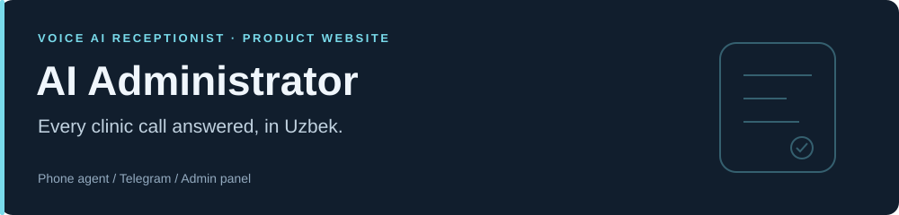

**The Uzbek-language website of AI Administrator — a voice AI receptionist that answers clinic phone calls, books appointments, and also replies on Telegram.**

[](https://github.com/akmalzokirjonov/ai-administrator/actions/workflows/ci.yml)

[Open live site →](https://akmalzokirjonov.github.io/ai-administrator/) · [Telegram](https://t.me/AISupportUzBot) · [Local development](#local-development)

## What this repository contains

The **public marketing website** for AI Administrator. The product has three parts, each in its own repository:

| Part | Repository |
|---|---|
| Website (this repository) | `ai-administrator` |
| Phone agent and clinic admin panel — the main product | `ai-administrator-voice` (private) |
| Telegram assistant for text and voice messages | `ai-administrator-bot` (private) |

The page presents a sample booking call, how the phone agent works, the phone/Telegram/admin-panel features, the booking safety rules, and the current pilot status. Every claim on the page comes from the product documentation in `ai-administrator-voice`; the demo clinic «Shifo» is fictional and the page says so.

## Highlights

- Responsive navigation and layouts for mobile and desktop.
- A missed-call versus answered-call comparison built from the agent's real acceptance dialogue.
- Navy, blue, and cyan visual styling with clear product sections.
- Keyboard focus, an accessible skip link, Escape-to-close mobile navigation, and reduced-motion support.
- Precompiled Tailwind CSS served from the repository: page styling does not require JavaScript.
- Static hosting with GitHub Pages.

### Keeping the content accurate

- Status numbers (20/20 test dialogues, 0 wrong bookings, first real-phone booking in November 2026) come from `docs/ntcc/PROGRESS.md` and `NTCC-SUMMARY.en.md` in the voice repository. Update them only from new measurements.
- No prices are shown: pricing for the phone agent has not been set yet.
- Items under «Navbatdagi qadamlar» are planned, not shipped. Move an item into the feature lists only after it works on a real phone.

## Technology

**HTML · Tailwind CSS 3 · CSS · Vanilla JavaScript**

Google Fonts supplies the typefaces and Material Symbols. Tailwind is a development dependency; its browser CDN is not required by the published page.

## Local development

To preview the committed site, only a static HTTP server is needed:

```bash
git clone https://github.com/akmalzokirjonov/ai-administrator.git
cd ai-administrator
python -m http.server 8765
```

Open [localhost:8765](http://localhost:8765).

When changing utility classes, the theme, or custom CSS, rebuild the stylesheet with Node.js 22+:

```bash
npm ci
npm run check
npm run build
```

Commit the regenerated `assets/styles.css` with the source change. CI checks JavaScript syntax and rejects a stylesheet that differs from a fresh build.

## Structure

```text
index.html               Content and semantic page structure
assets/styles.css        Generated, minified stylesheet served to visitors
assets/menu.js           Progressive mobile navigation
assets/favicon.svg       Product icon
src/input.css            Tailwind directives and custom styles
tailwind.config.cjs      Design tokens and utility generation
.github/workflows/ci.yml Build consistency checks
```

## Deployment

GitHub Pages serves the repository's `main` branch from its root. The generated CSS is committed, so Pages does not need a Node.js build step.

The Telegram links open an external bot. The website build checks do not verify the availability or behavior of that service.

## O'zbekcha

AI Administrator mahsulotining sayti. Mahsulot — klinika telefoniga o'zbek tilida javob beradigan va bemorni qabulga yozadigan ovozli AI administrator (`ai-administrator-voice`), Telegram yordamchisi (`ai-administrator-bot`) bilan birga. Bu repository faqat sayt kodini saqlaydi.

Saytni ochish uchun yuqoridagi **Open live site** havolasidan foydalaning.
