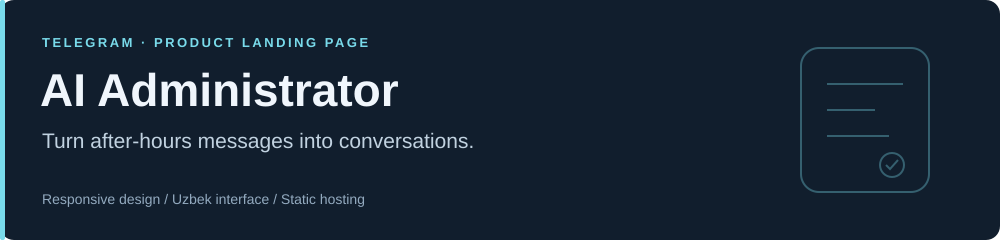

**An Uzbek-language product landing page for a Telegram sales assistant.**

[](https://github.com/akmalzokirjonov/ai-administrator/actions/workflows/ci.yml)

[Open live site →](https://akmalzokirjonov.github.io/ai-administrator/) · [Open demo bot](https://t.me/AISupportUzBot) · [Local development](#local-development)

## What this repository contains

The **public marketing website** for AI Administrator: a customer conversation comparison, product pricing, and Telegram calls to action. The Telegram bot backend, AI service, and CRM integrations are not part of this repository.

## Highlights

- Responsive navigation and layouts for mobile and desktop.
- Before-and-after conversation showing the value of after-hours responses.
- Navy, blue, and cyan visual styling with clear product sections.
- Keyboard focus, an accessible skip link, Escape-to-close mobile navigation, and reduced-motion support.
- Precompiled Tailwind CSS served from the repository: page styling does not require JavaScript.
- Static hosting with GitHub Pages.

## Technology

**HTML · Tailwind CSS 3 · CSS · Vanilla JavaScript**

Google Fonts supplies the typefaces and Material Symbols. Tailwind is a development dependency; its browser CDN is not required by the published page.

## Local development

To preview the committed site, only a static HTTP server is needed:

```bash
git clone https://github.com/akmalzokirjonov/ai-administrator.git
cd ai-administrator
python -m http.server 8765
```

Open [localhost:8765](http://localhost:8765).

When changing utility classes, the theme, or custom CSS, rebuild the stylesheet with Node.js 22+:

```bash
npm ci
npm run check
npm run build
```

Commit the regenerated `assets/styles.css` with the source change. CI checks JavaScript syntax and rejects a stylesheet that differs from a fresh build.

## Structure

```text
index.html               Content and semantic page structure
assets/styles.css        Generated, minified stylesheet served to visitors
assets/menu.js           Progressive mobile navigation
assets/favicon.svg       Product icon
src/input.css            Tailwind directives and custom styles
tailwind.config.cjs      Design tokens and utility generation
.github/workflows/ci.yml Build consistency checks
```

## Deployment

GitHub Pages serves the repository's `main` branch from its root. The generated CSS is committed, so Pages does not need a Node.js build step.

The Telegram links open an external bot. The website build checks do not verify the availability or behavior of that service.

## O'zbekcha

AI Administrator mahsulotining taqdimot sahifasi. Bu repository landing sahifa kodini saqlaydi; bot va AI backend kodi bu yerda joylanmagan.

Saytni ochish uchun yuqoridagi **Open live site** havolasidan foydalaning.
